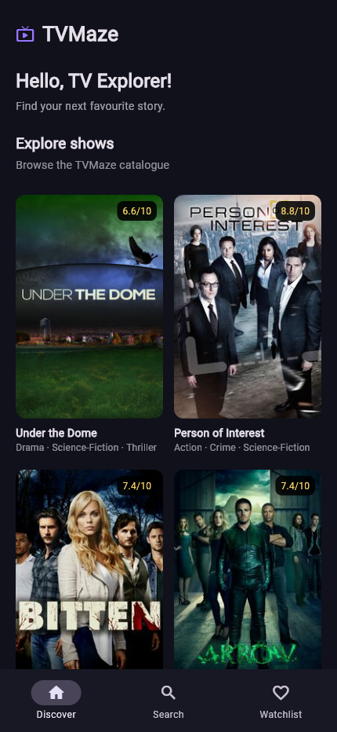
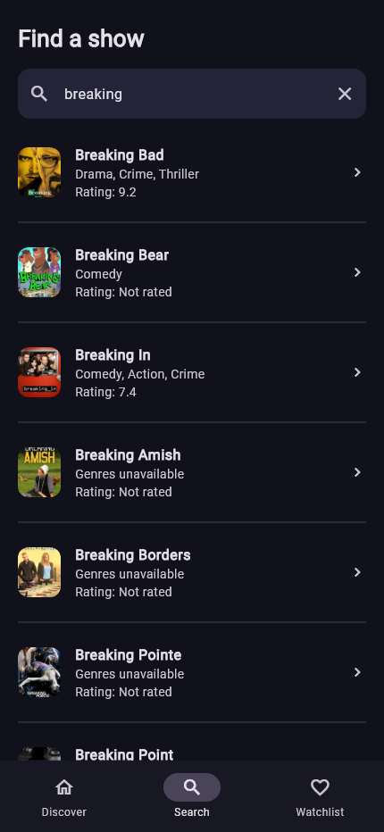
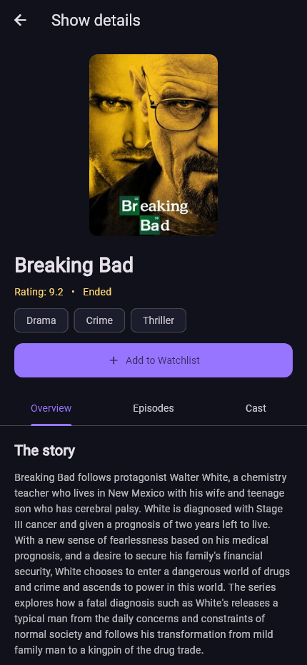
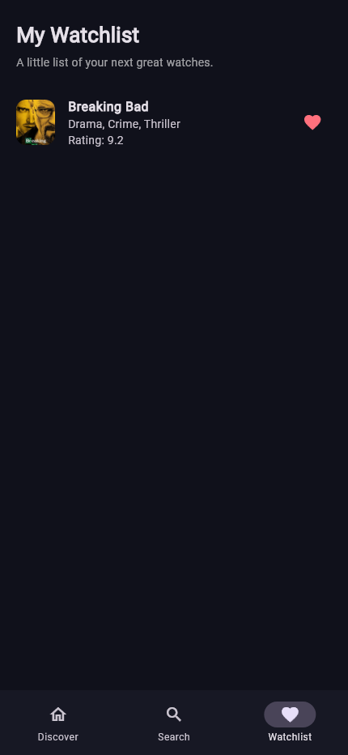
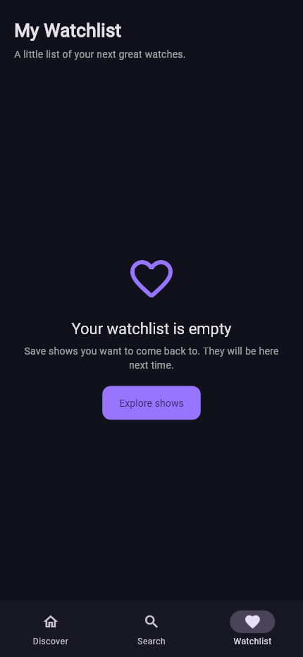
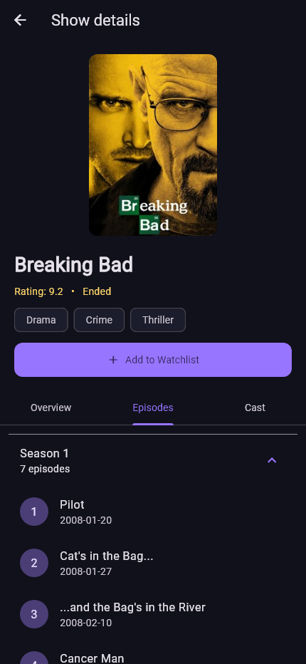
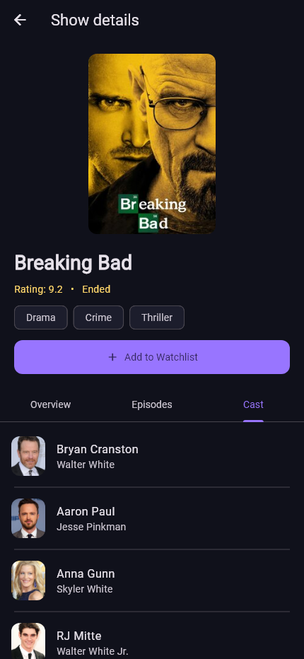

# TVMaze - CS4039 Assignment 02

A Flutter TV show discovery app using the public TVMaze API and event-based BLoCs. The dark theme and purple accents are inspired by the assignment reference, with a smaller three-tab interface suited to the required features.

## Run the project

1. Install Flutter stable and the Android SDK
2. Run `flutter doctor` and fix any Android toolchain issues.
3. Open this folder in VS Code or Android Studio.
4. Start an Android emulator or connect a phone with USB debugging enabled.
5. Run:

```sh
flutter pub get
flutter run
```

The project's Dart SDK constraint is `^3.13.2`; use a Flutter SDK that includes a compatible Dart version. No API key or account is required. Internet access is needed for discovery, search, details, cast and episodes. The saved watchlist's text data is stored locally; posters still need the network. Removing the app or clearing its storage removes the watchlist.

## Features

- Discover: API show catalogue, posters, names, genres, ratings, pull-to-refresh, infinite scrolling and retry.
- Search: name search with a 400 ms debounce and protection against outdated responses.
- Details: overview, cast and episodes grouped in expandable seasons.
- Watchlist: add/remove shows, saved as JSON using SharedPreferences and restored at startup.
- Loading, empty, error and missing-image states; a failed cast/episode request does not discard the overview.

The catalogue endpoint returns shows by ID; it is not a trending or popularity ranking. There is no hardcoded show data in the application.

## Structure

```text
lib/
  main.dart                    startup, dependencies and theme
  models/show.dart             Show, CastMember and Episode
  data/show_repository.dart    HTTP requests and response parsing
  data/watchlist_repository.dart  local JSON storage
  blocs/                       events, states and business logic
  screens/                     discover, search, watchlist and details
  widgets/common.dart          reusable poster, message and show row
```

Each BLoC file includes its events and state to keep this small project easy to follow. UI widgets dispatch events and render state; they do not make HTTP requests. `setState` is used only for the currently selected navigation tab, which is local presentation state.

## API and attribution

[TVMaze API documentation](https://www.tvmaze.com/api): `/shows?page=0`, `/search/shows?q=...`, `/shows/:id`, `/shows/:id/cast`, `/shows/:id/episodes`. Pagination stops on a 404 response (converted to an empty page), not on a page containing fewer than 250 shows. Requests time out after 20 seconds. A rate-limit response asks the user to wait and retry.

Show information and images come from [TVMaze](https://www.tvmaze.com/), under its [CC BY-SA terms](https://www.tvmaze.com/api#licensing). TVMaze attribution is also shown on the overview screen. This is an educational project and is not an official TVMaze app.

## Screenshots

See `docs/screenshots/` for captures of the actual app. Read the capture notes there for the method and limitations.


### App captures

| Discover | Search | Details |
| --- | --- | --- |
|  |  |  |

| Watchlist | Empty watchlist |
| --- | --- |
|  |  |

| Episodes by season | Cast |
| --- | --- |
|  |  |

